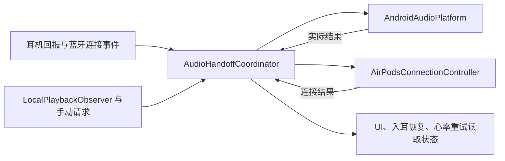

# Android 音频切换重构方案

日期：2026-09-05。状态：切换核心、路由执行、手动接管与自动媒体观察已实现，正在完成交付验证；设备安装与实机验收待安排。

## 目标与已确定的规则

优先解决手机与 Mac 之间的抢音频、切换后无声和恢复困难。用户已选择：Mac 播放时，手机通知和提示音不抢占；手机明确发起媒体播放或手动选择耳机时允许接管。

重构围绕这条切换链路实施。现有协议解析、心率算法、Health Connect、设置页面及 Linux 客户端继续作为可复用部分；它们与切换核心的接口按需要调整。

| 情况 | 目标行为 |
| --- | --- |
| Mac 播放，手机出现通知、充电提示或其他短提示音 | 手机出声，Mac 播放保持 |
| 手机主动开始媒体播放，具备可靠的应用与播放意图证据 | 发起一次有截止时间的手机接管 |
| 用户在 LibrePods 中选择“在手机使用耳机” | 明确接管，覆盖自动远端保护；显示进行中、成功或失败 |
| 用户在系统输出选择器选择 AirPods | 在系统事件确实可区分主动选择时，作为手动意图；不可区分时不伪造该信号 |
| 本地已接通通话或主动拨号 | 独立处理通话路由；来电铃声不等同于已经接通的通话 |
| 耳机回报暂时缺失或矛盾 | 保留最后一条有效证据的时间，在一个有界窗口内查询；自动任务不据此抢占 |
| 用户主动断开或选择其他输出设备 | 取消尚未完成的自动接管和重连 |
| 心率监测需要重试 | 在音频允许时恢复心率，不自行决定音频归属 |

“主动播放”不等同于 `USAGE_MEDIA`、`isMusicActive` 或 A2DP `PLAYING`。Android 对其他应用的真实点击行为没有通用、可靠的公开回调。第一阶段要验证本机可取得的音频焦点、MediaSession、播放 UID 和输出设备信号；未能确认意图时保持当前归属，并提供明确的接管入口。

## 调研基线与证据边界

- 工作目录：当前仓库；分支 `android/airpods-pro3-heart-rate`；HEAD `2b27903`，另有大量既存未提交修改。实施基线必须包含工作区，不能只从 HEAD 开始。
- 当前 `AirPodsService.kt` 为 5,533 行，`RemoteDeviceAudioGuard.kt` 为 764 行。本地保存的上游参考提交 `a573241` 中 Service 已有 3,927 行；行数只辅助定位职责集中问题。
- 只读设备检查：Android 17 / HyperOS 4；应用及系统模块内 APK 均为版本代码 89，二者 SHA-256 一致。尚未证明已安装 APK 与当前工作区源码完全对应。
- 临时目录编译当前源码后，保护状态机及健康状态共 40 项 JVM 测试通过。未运行本轮完整 Gradle 构建或全项目测试。
- 当前源码事件回放已证实：新远端播放证据未重置旧宽限期起点；永久屏障失败的 OFF 状态能被同一连接的下一条远端事件重新激活。
- 路由执行代码的风险已定位：未检查反射调用的业务返回值；清理失败后丢弃恢复记录；原生 START 阻断仅依赖 policy 注册状态，不能证明现有媒体流已转到扬声器。
- 手动重连目前只恢复连接并绕过部分 profile 保护，没有统一的音频接管完成判定。
- 设备采样时 A2DP/HFP 未连接，未取得一次故障发生过程。上述代码缺陷与用户实际故障之间仍需现场关联。

## 架构选择

采用一个切换协调器，复用现有协议层及系统执行代码。避免再为每个补丁建立一套独立状态机、计数器和恢复任务。

| 组件 | 职责 | 现有代码去向 |
| --- | --- | --- |
| `AudioHandoffCoordinator` | 唯一的切换决策入口；选择目标、管理当前操作、处理完成与失败 | 吸收 guard、Service 内的音频归属判断、手动恢复编排和重连策略之间的重复决策 |
| `AndroidAudioPlatform` | 读实际输出，应用与撤销路由，桥接现有原生租约，返回实际结果 | 从 `PhoneSoundRoutingController` 修正并收敛；不再自行判断音频归谁 |
| `AirPodsConnectionController` | 管理当前 AACP 会话、取消过期任务，执行 A2DP/HFP 连接与有限重试 | 复用 `BluetoothConnectionManager`，逐步移出 Service 的重连执行逻辑 |
| `LocalPlaybackObserver` | 将本机可用的焦点、播放会话、播放 UID 和路由变化转为带来源的事实 | 替代与永久关闭的周期上报开关绑定的旧播放监听；不发送切换命令 |

`AirPodsService` 继续负责 Android Service 生命周期、广播注册与现有功能接线，逐步移出切换决策。无需先把整个 Service 拆完才能交付稳定性改善。

### 最少需要保留的数据

协调器明确区分三类信息：

1. **事实**：当前连接会话、耳机回报的音频源及其观测时间、实际 A2DP/HFP 状态、实际输出设备、路由执行结果。
2. **意图**：手动选择、已接通通话、可信的本地媒体启动、主动断开。意图不能直接改写“已观察到的音频源”。
3. **当前操作**：至多一个音频切换操作，包含目标、原因、操作编号和截止时间。连接会话编号与切换操作编号分别隔离旧连接和同一连接里的旧操作。

故障与能力状态单独表达，不再把“用户关闭”“通道断开”“永久失败”统统装进一个 OFF 状态。具体类型在实现时按实际需要定义，不预先增加一批确认中状态。

有效的远端证据统一更新一个观测时间。依据该时间计算失效窗口，避免宽限期起点、阶段终点、下一次轮询时间相互充当证据。

### 并发与执行约束

- 状态更新串行处理；蓝牙 socket 写入、Binder 调用和路由操作在可取消的执行任务中完成，不能堵住决策处理。
- 启动外部操作前及处理其结果时，都校验连接会话和当前操作。旧结果不能完成新操作。
- 同一目标的重复观察更新事实，不反复注册相同路由、创建相同重连或重置操作截止时间。
- 关停、主动断开和取消是必须保留的事件；高频重复观察可合并。队列异常必须显式暴露，避免无界排队。
- 切换期间仅有一个实际执行者。过渡期的新旧实现通过测试构建选择，不能同时控制系统路由。
- 当前 `AudioProfileRepairFence` 等保护在其所有调用点完成迁移前保留；不能只因有了串行协调器就假定跨线程的外部副作用已经串行。
- 迁移时枚举所有改变所有权、A2DP/HFP 和系统路由的调用点，包括初始化与远端释放请求的直接回包；这些请求必须经过同一决策入口。纯查询和心率数据传输继续使用既有协议接口。

## 两条核心执行流程

### 保护远端播放

1. 收到同一连接会话内有效的远端播放证据，更新观测时间。
2. 取消与远端保护冲突的自动 profile 修复和入耳恢复。
3. 路由执行层确认需要保护的手机音频具备可用输出，包括已经创建的媒体流。
4. 仅在路由前提满足后，启用已验证可用的原生 START 阻断。
5. 路由失败时报告实际能力，撤销会制造无声的部分操作；清理未成功的资源继续保持可追踪状态。

原生拦截是否在 Android 17 / HyperOS 4 仍然必要，以及租约是否可获得轻量回执，在能力验证阶段决定。现有单向偏好写入成功不代表蓝牙进程已完成启用或清除。若无法确认，状态应保持未知，并通过实机验证选择可恢复的实现，不新增通用跨进程消息框架。

### 手机接管

1. 接受明确的手动请求或可信的本地媒体意图，建立唯一切换操作并使旧操作失效。
2. 协调撤销当前阻断与扬声器路由；不会只绕过 profile fence 而保留其他保护。
3. 按需要恢复 A2DP/HFP，使用当前协议层提供、且经本机验证的控制操作。先采用最小有效序列，不恢复整套历史 takeover 代码。
4. 依据目标音频 profile、实际输出和新鲜耳机音频源证据判定进展。写入成功、ownership bit 和“蓝牙已连接”均不能单独判定已完成。
5. 到达截止时间后结束自动尝试，显示可解释的失败和一次明确的重试入口。保留仍未清理成功的执行状态，避免假报恢复完成。

“释放耳机”如纳入 UI，语义仅为手机放弃占用；不能保证 Mac 自动连接或自动播放。是否需要独立释放按钮在核心接管流程稳定后决定。

## 实施顺序与交付物

| 阶段 | 工作 | 交付与完成条件 |
| --- | --- | --- |
| 0. 固定基线 | 保存包含当前未提交改动的源码快照；记录现有 APK、模块、签名与必要设置；建立独立实施分支 | 恢复路径可用；不替用户提交既存 WIP；明确源码与安装包对应关系 |
| 1. 验证系统能力与执行层 | 验证 Android 17 路由返回值、实际输出观测、焦点/播放会话可用性、原生 hook 与租约清除；修正路由设置和清理的结果处理 | 可复用的路由执行层；能力表标注已验证/不可用/未知；已知反例成为后续验收场景 |
| 2. 实现切换核心与手动恢复 | 建立协调器及有限的连接执行接口；接入明确手动接管；统一实际完成/失败反馈 | 第一版可安装测试构建；手动切换成功，失败后也可重试或取消；没有新旧执行器争用 |
| 3. 接入自动媒体接管 | 根据实机确认可用的信号实现意图识别；通知及自动播放误判单独验证；入耳恢复、心率重试读取统一状态 | 主动媒体可接管，短提示音不抢；观察器证据不足时有手动入口 |
| 4. 回归和删除旧逻辑 | 验证核心实机场景；移除已被替代的 guard 状态、重复计时/重试和永久关闭分支；补必要维护文档 | 一个决策入口和一个实际执行路径；相关测试、完整构建与设备结果分别记录 |

第一批修改优先落在可以复用的路由执行层和切换核心。已经定位的旧 guard 缺陷用于验证新核心，不继续在旧状态机上堆叠一轮临时架构。

每阶段提供独立、可审查的差异。涉及 native / Xposed 的测试包与 root 模块必须匹配；安装与重启安排在包及恢复路径准备完成之后。

## 验证方式

### 自动验证

- 事件时间线：远端播放持续确认、短暂缺报、乱序与旧连接回报；验证最新证据决定期限。
- 故障注入：路由方法返回失败、部分设置成功、清理失败、迟到回调、连接超时；验证不会假报成功或丢失待清理资源。
- 真实编排测试：驱动协调器和执行接口，检查实际执行顺序及取消行为，不只验证 reducer 返回的动作列表。
- 保护前提：没有可用手机输出时不得把原生拦截维持为“正常保护”；旧操作不得重新启用已撤销的保护。
- 生命周期：同一目标请求合并、手动断开后不自动重连、系统服务重启后清理记录仍可恢复。
- 在 Android Gradle 根目录运行相关测试、全套 `testFossDebugUnitTest`、`assembleFossDebug`；触及模块时运行 `zipDebugModule` 并验证包一致性。

### 实机验收矩阵

| 场景 | 需要确认的结果 |
| --- | --- |
| Mac 持续播放；手机通知、充电、发送消息提示音 | Mac 音频连续；手机提示音有正确输出 |
| Mac 持续播放；手机音乐/视频主动开始 | 手机有声，界面状态与实际输出一致 |
| 手机应用自动预览或无焦点播放 | 不被轻易误判为明确的接管意图 |
| 手动选择手机使用耳机 | 操作完成或明确失败；失败后无需重启应用才能重试 |
| 手机与 Mac 连续双向切换至少 10 轮 | 每轮记录实际出声、耗时、失败和恢复方式；没有累积退化 |
| 手机通话接通、结束及远端切换 | 通话路由正确，结束后不残留阻断或扬声器强制路由 |
| 短暂 AACP / 蓝牙断开与重新连接 | 有界恢复，不借机抢远端音频 |
| 服务重启、系统蓝牙重启 | 无遗留路由；连接和保护状态可重新确认 |
| 开启心率与入耳检测后重复核心场景 | 心率/入耳恢复不与音频切换争用 |

系统重启和真实通话测试需安排在不影响用户使用的时段。不得通过无人值守自动拨号来完成通话验证。

### 诊断数据

调试期间记录有限大小的事件时间线：时间、匿名设备/会话标识、触发来源、期望输出、实际结果和失败原因。音频决策关键事件串成一次切换记录；默认不采集媒体标题、通话对象、配对密钥或原始协议帧。结束验证后关闭高频采样。

实机切换延迟先测基线，再确定验收阈值。源码检查、JVM 测试、APK 构建与实际可听结果分别报告。

## 用户需要配合的部分

切换规则已经确定，架构设计、源码修改和自动测试可以独立推进。

需要用户参与的只有短时现场验证：操作 Mac 与手机播放、发出几类常用提示音、在合适时段验证通话，并反馈声音实际从哪里出来、是否出现停顿。日志能够说明系统如何报告状态，最终可听体验仍需要用户确认。

首轮能力采样可与第一次测试构建验证合并，预留约 15–20 分钟；若出现偶发故障，后续再针对具体场景采样。应用与匹配模块、安装步骤、恢复包和测试清单准备完成后，再进行设备替换与重启。

## 实施记录（2026-09-05）

- 实施分支：`codex/audio-handoff-redesign`。开始前已校验包含既存未提交改动的源码备份；原分支的 WIP 没有被提交或清除。
- 替换了旧 `RemoteDeviceAudioGuard`，并移除 Service 中的 guard 事件队列、动作二次排序、独立 tick 调度和永久关闭的媒体上报分支。Service 保留 Android 生命周期和其他已有功能。
- 新核心位于 `android/app/src/main/java/me/kavishdevar/librepods/audio/`；手动接管、远端释放请求、自动播放观察、通话及重连许可从这里协调。
- 路由恢复记录保存原先的设备选择。设置、撤销均检查返回值并回读；失败记录保留到恢复成功，用户后来的输出选择不被清理流程覆盖。
- 原生层沿用现有 LSPosed 偏好租约，增加一次带版本号的应用回执；默认发布 2 秒租约。未确认可用时不把“偏好写入成功”当成已启用原生拦截。
- 自动媒体接管要求新的 MediaSession 播放边沿、对应 UID 的媒体音轨和完整媒体焦点共同出现；允许短暂的事件先后差。已有播放、无焦点预览、通知音不能仅靠 A2DP 状态触发接管。
- 应用实际需要 `MEDIA_CONTENT_CONTROL`，已同时加入 manifest 与匹配 root 模块。手机上的 root 只读探针已调用焦点和输出查询；媒体会话探针被系统终止，不能视为应用权限已验证。
- 手机接管完成必须同时满足本操作的保护释放回执、目标音频 profile、系统输出和新鲜耳机音频源。空闲手动连接显示可用状态，不声称音频正在播放。
- 诊断通过 Service `dump` 提供最多 64 条决策记录；`capabilities` 参数可只读验证实际应用身份下的观察权限，不输出媒体标题或配对密钥。
- 测试版版本：`1.0.2-handoff.1-debug`，版本代码 90。匹配 APK、模块与旧版本恢复包已生成；仍需最终安装与可听体验验收。

尚未验证：真实媒体点击与应用自动播放的区分效果、系统输出选择器的用户意图识别、Mac/手机连续切换、通话、服务/蓝牙重启、心率同时运行。本次没有为系统输出变化伪造“用户主动选择”事件；明确手动接管入口已提供。

## HyperOS 4 实机回归修正（2026-09-05）

用户反馈 handoff.1：TG 发送提示音抢占 Mac，但提示音未在耳机播放；手机播放后 Mac 不容易接管。通过 USB `5c4fdf81` 读取到 Android 17 / `OS4.0.0.6.XOCCNXM`，已安装应用及系统包均为 90。应用权限已授予，但 `hiddenApiEnforcementPolicy=2`、`usesNonSdkApi=false`，播放观察报 NoSuchMethodException，保护在连接后立即失败。

修正及验证：

- 为特权系统应用声明 `android:usesNonSdkApi=true`。临时覆盖安装诊断版 91 后，现场策略变为 0，焦点和媒体会话读取成功。
- 91 暴露了第二个确切接口差异：Android 17 已移除 `AudioProductStrategy.getAudioProductStrategies()`，改用 `AudioManager.getAudioProductStrategies()`。92 优先调用新入口，旧系统保留旧入口；调用失败不会被兼容分支隐藏。
- Mac 的释放回复不再等待 Android 路由互斥锁或路由操作成功。两项新增测试在修改前均超时，修改后通过。
- 移除 GestureFeedback 加载完成后的零音量 SoundPool 播放。加载仍保留，实际手势反馈功能仍可播放，应用启动不再为了预热主动创建无声音轨。
- 增加应用内“复制切换诊断”，方便无 ADB 时反馈。

最终待测构建为 `1.0.2-handoff.3-debug / 92`，242 项 JVM 测试及 APK/模块构建通过，匹配包在 Downloads/LibrePods-handoff.3-test。USB 暂时断开前，只覆盖安装了诊断版 91；系统活动模块仍为 90，原生库已核对与新版逐字节一致。92 尚未安装或完成实机音频复测，不能声称 TG 防抢占与 Mac 接管已经在设备上验证修复。

## handoff.3 冷启动验证（2026-09-06）

应用及模块 92 已由 USB 验证安装一致。冷启动后出现 Mac 正在输出但耳机无声：Mac 认为自己已拥有设备，耳机对手机却持续回报 NONE；此时 LibrePods 无保护屏障、无接管操作。用户同意的停 App 对照未恢复声音，Mac 本地测试音也无声。

用户点击手机接管按钮后，Mac 的 ownership 先变为 false，再于播放时从 0 变 1；声音恢复，用户确认之后手机媒体接管、Mac 接管和通知不抢均正常。正常远端播放时，手机侧已确认 registered speaker route、preferred route 与 native acknowledgement。

范围收敛为首次连接的音频归属同步。不能自动照搬完整按钮动作作为开机修复；仍需独立验证最小初始化步骤。免按钮冷启动尚未解决。现场证据位于本地 `../../librepods-recovery/silent-mac-20260906-015654`，不要把含原始设备信息的日志提交到仓库。

## 首次连接单步诊断准备（2026-09-06）

handoff.4 / 93 是诊断构建，自动切换逻辑未新增初始化动作。该构建补充实际 ownership 回报、音源所属主机和连接时序，并注册仅限 debug、要求调用方具备 DUMP 权限的固定命令 `AUDIO_DIAGNOSTIC_RELEASE_IDLE_OWNER`。

该命令仅在当前连接有新鲜 NONE 音源、无本地播放/通话、无接管操作且未被用户断开时，发送 `OWNS_CONNECTION=false` 并查询音源。它不执行主动接管、profile 重连或活动设备选择，目的是与现有按钮分离验证。

246 项 JVM 测试通过，APK 和模块已构建、签名及内嵌 APK 一致性已核对，包在 Downloads/LibrePods-handoff.4-diagnostic。尚未安装或执行该诊断命令。当前手机的已验证工作版本仍为 92，正常状态未改变。

下一轮需要重新出现冷启动无声现场，先保存诊断，再执行单条空闲声明。只有验证能够恢复后，才决定自动初始化方案；目前不将该实验标为修复完成。

## 普通媒体验收与企业微信占用（2026-09-06 上午）

用户验证 handoff.4 / 93：双端自动连接、Mac 播放与通知保护、手动接管、Mac 从手机接回均符合预期。Mac 暂停后手机难以接管的本次现场，最终由退出 Mac 企业微信恢复；无需改手机代码或发送诊断命令。

CoreAudio 在网易云停止后仍检测到企业微信 PID 852 保持输出。PowerUsageWatchdog 记录其 Default-Output AudioQueue 从 9 月 4 日 17:37:29 创建，存活 139716 秒，检查时仍 Running/Active；该队列跟随默认输出连接 AirPods。企业微信退出后耳机输出流停止，用户确认手机正常。

本轮曾针对静音音轨识别准备试改，但在对照确认企业微信占用后已完整撤回，继续保留用户验证正常的 93 版。不要把本次现象当成需要扩大手机自动接管权限的依据。企业微信内部哪个功能保持队列尚不确定，会议和电话场景仍待测试。

## 手动切换入口调整（2026-09-06 下午）

handoff.5 / 94 只调整手动操作入口：App 内移除接管和取消按钮，保留状态与复制诊断；连接状态通知新增“切换到手机”，切换中显示“取消切换”；控制中心新增独立的同名磁贴，原降噪磁贴保持原行为。通知和磁贴继续调用原有 `takeAudioOnPhone()` / `cancelAudioHandoff()`，打开 App 或展开控制中心不会发起接管。

通知通过非导出的显式广播接收操作，磁贴只在系统监听期间观察状态；通知保留按实际内容去重及静默更新。音频核心、蓝牙协议、路由、心率和原生拦截源码保持 93 版，未继续此前的架构清理。

246 项 JVM 测试通过，APK 与模块构建成功；签名沿用现有证书，模块内 APK 与独立 APK 完全一致，16 个原生库与 93 版相同。安装包放在 Downloads/LibrePods-handoff.5，交由用户手动安装；新入口尚未实机验证，会议和电话场景仍未验收。
